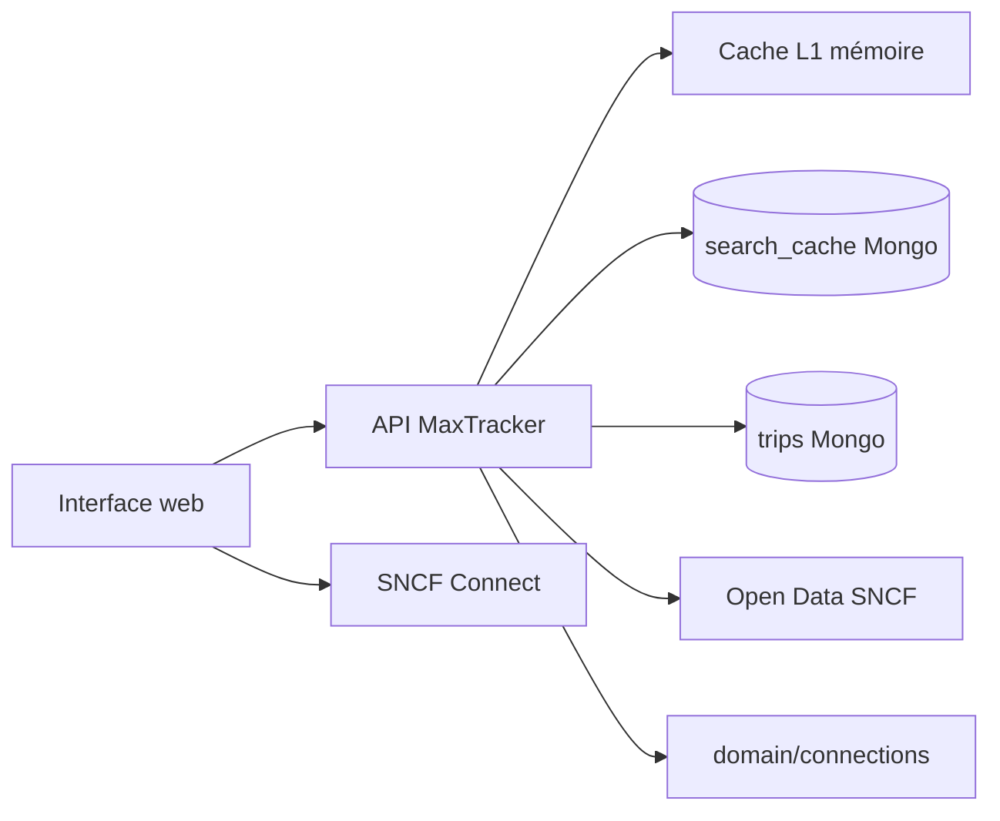

# MaxTracker

Site web gratuit pour repérer les trains **TGV Max à 0 €** depuis votre gare de départ, en direct ou avec correspondance (TGV INOUI, Intercités, Intercités de nuit), sans parcourir destination par destination sur SNCF Connect.

**Pour qui ?** Titulaires d'un abonnement **MAX Jeune ou MAX Senior** (offres TGV Max).

**Ce que c'est :** un outil de repérage **indépendant et non officiel** qui agrège les [données ouvertes SNCF](https://data.sncf.com/explore/dataset/tgvmax/), compose des parcours multi-segments lorsque c'est possible, puis vous **redirige** vers [SNCF Connect](https://www.sncf-connect.com) pour réserver.

**Ce que ce n'est pas :** un site SNCF, un service de vente de billets ni une application de réservation. MaxTracker ne réserve pas à votre place et ne collecte aucun identifiant SNCF Connect.

---

## Sommaire

- [À quoi ça sert ?](#à-quoi-ça-sert-)
- [Fonctionnalités](#fonctionnalités)
- [Comment l'utiliser](#comment-lutiliser)
- [Ce que vous pouvez faire](#ce-que-vous-pouvez-faire)
- [Bon à savoir](#bon-à-savoir)
- [Avertissement](#avertissement)
- [Pour les développeurs](#pour-les-développeurs)

---

## À quoi ça sert ?

Si vous avez un abonnement TGV Max, MaxTracker répond à une question simple : *« Quels trajets à 0 € puis-je prendre depuis ma gare dans les 30 prochains jours ? »*

L'application interroge une base alimentée par le jeu ouvert [« Disponibilités TGV Max »](https://data.sncf.com/explore/dataset/tgvmax/) publié par SNCF Voyageurs. Elle affiche les **trajets directs** et, lorsque les créneaux s'enchaînent correctement, des **parcours avec correspondance** (jusqu'à 1).

Le moteur sait composer des parcours jusqu'à **2 correspondances** (3 trains), mais cette profondeur n'est pas proposée en production. 
Voir le [rapport de limitation](doc/rapport-limite-correspondances.md) pour le détail des mesures.

La SNCF publie une nouvelle vague de données **chaque jour en début de matinée** (aux alentours de 6 h 30). MaxTracker importe ce flux environ **toutes les 15 minutes** : ce n'est pas du temps réel, mais cela permet de rafraîchir régulièrement les trajets éligibles et les heures de départ.

Pour le détail des filtres, des parcours composés, des horodatages affichés et des écarts possibles avec SNCF Connect, voir la page **À propos** dans l'application (`#/about`) ou le fichier [front/src/pages/About.jsx](front/src/pages/About.jsx).

---

## Fonctionnalités

- Recherche par gare de départ, résultats groupés par ville d'arrivée
- **Trajets directs** et **parcours avec correspondance** (filtre : direct ou 1 correspondance)
- **Filtres simples** : type de train, correspondances max
- **Filtres avancés** : horizon de dates (7 / 14 / 30 j, défaut 30 j), créneaux horaires, durée totale max (≤ 3 h / 5 h / 8 h), départ aujourd'hui, et départ week-end uniquement
- Vues **Liste**, **Calendrier** (sur l'horizon choisi, un clic sur un jour filtre la liste) et **Pics horaires**
- **Recherche de destination** dans les résultats (« Où voulez-vous aller ? »)
- Badge **« Départ possible aujourd'hui »**, badge **« Imminent »** (< 4 h), mention **« +1 j »** sur les arrivées le lendemain
- Gares **favoris**, **masquage** de destinations, **sync manuelle**
- **Lien partageable** : gare, filtres et vue sont dans l'URL (bouton « Précédent » compris) ; derniers filtres mémorisés d'une visite à l'autre
- **Mode clair / sombre** (préférence mémorisée, transition en fondu au basculement)

---

## Comment l'utiliser

Ouvrez l'application web, puis :

1. **Saisissez votre gare de départ** (au moins 3 lettres pour l'autocomplétion)
2. Lancez la recherche
3. Parcourez les résultats **par ville de destination** (trains directs et parcours composés, triés par date)
4. Affinez avec les **filtres** dans le panneau *Filtres simples* / *Filtres avancés* (ou la feuille mobile)
5. Cherchez une ville précise avec **« Où voulez-vous aller ? »**, puis changez de vue : **Liste**, **Calendrier** ou **Pics horaires**
6. Ouvrez **SNCF Connect** depuis chaque train pour réserver (un lien par segment sur les parcours avec correspondance)

**Astuces**

- **Gares favorites** enregistrées localement dans votre navigateur
- **Partagez une recherche** en copiant l'adresse de la page : elle contient la gare, les filtres et la vue
- **Calendrier** : cliquez sur un jour pour n'afficher que ses trajets
- **Masquer** une destination que vous ne voulez plus voir (réversible via « Réafficher tout »)
- **Correspondances max** : *Direct* par défaut ; passez à *1 correspondance* pour voir les parcours composés
- **Horizon de dates** : 30 j par défaut ; réduisez à 7 ou 14 j pour alléger la liste
- **Durée totale max** : utile pour les allers-retours à la journée (porte à porte, attentes incluses)
- Badge **« Départ possible aujourd'hui »** : au moins un départ encore possible aujourd'hui vers cette ville
- Badge **« Imminent »** : départ dans moins de 4 heures
- Le header affiche deux horodatages : dernière publication **SNCF** et dernière importation **MaxTracker**
- Bouton de **sync manuelle** pour forcer un rafraîchissement des données (l'import SNCF prend ~5 s ; l'icône peut encore tourner ~20 s pendant la reconstruction du cache)
- Icône **soleil / lune** dans le header : bascule le thème clair / sombre avec un fondu progressif

---

## Ce que vous pouvez faire

| Besoin | Dans l'app |
|--------|------------|
| Voir tous les départs à 0 € depuis une gare | Recherche par gare de départ |
| Comparer les destinations | Liste groupée par ville |
| Ne garder que les trajets directs | Filtre *Correspondances max* → Direct |
| Autoriser 1 changement de train | Filtre *Correspondances max* → 1 |
| Limiter aux 7 / 14 / 30 prochains jours | Filtre *Horizon de dates* |
| Aller-retour à la journée | Filtre *Durée totale max* |
| Ne garder que les départs du jour | Filtre *Départ aujourd'hui* |
| Cibler le week-end ou un créneau | Filtres week-end et horaires |
| Ne garder que TGV INOUI ou Intercités | Filtres par type de train |
| Trouver une ville précise | Champ « Où voulez-vous aller ? » |
| Planifier sur le mois | Vue calendrier (clic sur un jour → trajets de ce jour) |
| Partager une recherche | Copier l'adresse de la page |
| Repérer les meilleures heures | Graphique des pics horaires |
| Réserver | Lien(s) SNCF Connect (par segment si correspondance) |

Si **aucun train éligible** n'apparaît pour votre gare, l'app vous l'indique clairement : les places se libèrent souvent par vagues, réessayez plus tard.

Si la gare n'est **pas desservie** par l'offre TGV Max, un message d'erreur vous le signale.

---

## Bon à savoir

- **Vérifiez toujours sur SNCF Connect** avant de vous déplacer. Un train éligible affiché ici peut avoir été réservé entre deux mises à jour.
- **Fenêtre de 30 jours** : seuls les départs dans les 30 prochains jours sont indexés. Le filtre *Horizon* restreint cette plage côté interface.
- **Parcours composés** : chaque trajet doit être réservable à 0 € ; temps de correspondance minimum 25 min (même gare) ou 50 min (même métropole). Ce ne sont pas des itinéraires garantis par la SNCF, mais des enchaînements calculés depuis l'open data. L'interface se limite à **1 correspondance** (2 trains) : voir [rapport de limitation](doc/rapport-limite-correspondances.md).
- **Pas de réservation ici** : MaxTracker affiche les créneaux éligibles ; la vente et le paiement restent sur les canaux officiels SNCF.
- **Écarts possibles avec SNCF Connect** : l'app officielle s'appuie sur des systèmes privés en temps réel ; MaxTracker n'utilise que le flux public open data.
- **Service non officiel** : MaxTracker n'est pas affilié à la SNCF. Les marques citées (« SNCF », « TGV Max », « SNCF Connect », etc.) appartiennent à leurs propriétaires respectifs.

---

## Avertissement

MaxTracker **n'est pas affilié à la SNCF**. « SNCF », « TGV », « TGV Max », « MAX JEUNE », « MAX ACTIF » et « SNCF Connect » sont des marques déposées de leurs propriétaires respectifs.

Les données affichées proviennent du portail [data.sncf.com](https://data.sncf.com/explore/dataset/tgvmax/), sous la licence indiquée par le portail open data. L'application ne collecte pas d'identifiants SNCF Connect et n'effectue aucune transaction.

---

Les retours se font via les issues GitHub.
Il n'y a pas de support commercial ni de lien avec la SNCF pour les disponibilités ou les réservations.

<details>
<summary><h2>Pour les développeurs</h2></summary>

Ce dépôt contient le code source de MaxTracker (API FastAPI + interface React). Les sections ci-dessus décrivent le service tel qu'un utilisateur le voit ; ce qui suit concerne l'installation et le développement local.

### Démarrage local

**Prérequis :** Python 3.11, Node.js 20.19+ (requis par Vite), MongoDB.

**MongoDB local fortement recommandé** pour des temps de réponse corrects (cache de recherche ~200 Mo) : une source distante ajoute une latence réseau importante sur les interactions utilisateur.

```bash
# MongoDB (macOS, Homebrew)
brew tap mongodb/brew
brew install mongodb-community@8.0
brew services start mongodb/brew/mongodb-community@8.0

# Backend
cd back
cp .env.example .env
# Par défaut : MONGO_URL=mongodb://127.0.0.1:27017
python3 -m venv .venv && source .venv/bin/activate
pip install -r requirements-dev.txt   # dépendances de l'app + outils de test
uvicorn server:app --reload --port 8000

# Frontend (autre terminal)
cd front
npm install
npm start
```

- API : [http://localhost:8000/api/](http://localhost:8000/api/)
- App : [http://localhost:3000](http://localhost:3000)
- OpenAPI : [http://localhost:8000/docs](http://localhost:8000/docs)

Au premier lancement avec une base vide, une **sync SNCF automatique** s'exécute (~5 s d'import). Le bouton de sync manuelle peut rester actif **~20 s de plus** le temps du préchauffage du cache de recherche.

### Structure du dépôt

```
tgvmax-platform/
├── back/                          # API FastAPI
│   ├── server.py                  # Point d'entrée Uvicorn
│   ├── requirements.txt           # dépendances de production
│   ├── requirements-dev.txt       # + pytest (développement, CI)
│   ├── runtime.txt                # Version Python (Render)
│   ├── .env.example
│   ├── app/
│   │   ├── main.py                # Lifespan, scheduler, wiring
│   │   ├── config.py
│   │   ├── dependencies.py
│   │   ├── api/
│   │   │   ├── router.py
│   │   │   └── routes/            # health, search, stations, sync
│   │   ├── core/
│   │   │   ├── logging.py
│   │   │   ├── rate_limit.py      # limite cold compute 
│   │   │   └── memory_cache.py    # cache L1 process-local
│   │   ├── db/
│   │   │   ├── mongodb.py
│   │   │   └── repositories/      # trips, sync_state, search_cache
│   │   ├── domain/
│   │   │   ├── connections.py     # règles métier correspondances
│   │   │   ├── stations.py        # métropoles / hubs
│   │   │   ├── train_classifier.py
│   │   │   └── trips.py
│   │   ├── schemas/               # modèles Pydantic (API)
│   │   └── services/
│   │       ├── search.py          # cache L1/L2, recherche, warm cache
│   │       ├── connections.py     # mapping domain → DTO
│   │       ├── sync.py            # pipeline SNCF → Mongo
│   │       └── sncf/              # client Open Data + liens Connect
│   └── tests/
├── front/                         # SPA React (Vite)
│   ├── index.html                 # point d'entrée Vite
│   ├── vite.config.mjs            # alias @/, port 3000, sortie build/, Vitest
│   ├── src/
│   │   ├── components/
│   │   │   ├── AppRouter.jsx      # navigation Recherche / À propos
│   │   │   ├── ConnectedTripCard.jsx, DestinationGroup.jsx…
│   │   │   └── ui/                # composants Radix / shadcn
│   │   ├── hooks/
│   │   │   └── useSearchTrips.js  # React Query (search + prefetch)
│   │   ├── pages/
│   │   │   ├── Home.jsx
│   │   │   └── About.jsx
│   │   └── lib/                   # api, sncfConnect, storage, tripKeys, tripTime, utils
│   └── package.json
├── doc/
│   ├── regles-de-gestion.md
│   ├── contraintes.md
│   └── rapport-limite-correspondances.md
└── .github/
    ├── workflows/ci.yml           # CI : tests backend (+ MongoDB), lint/tests/build frontend
    └── ISSUE_TEMPLATE/, PULL_REQUEST_TEMPLATE.md
```

### Variables d'environnement

**Backend** (`back/.env`) :

| Variable | Obligatoire | Description |
|----------|-------------|-------------|
| `MONGO_URL` | Oui | URI MongoDB |
| `DB_NAME` | Oui | Nom de la base (ex. `tgvmax`) |
| `CORS_ORIGINS` | Oui | Origines autorisées (séparées par des virgules) |

Optionnel :

| Variable | Défaut | Description |
|----------|--------|-------------|
| `SYNC_INTERVAL_MIN` | `15` | Intervalle de sync automatique |
| `CACHE_WARM_CONCURRENCY` | `8` | Parallélisme du warm cache post-sync |
| `SEARCH_RESULT_LIMIT` | `20000` | Garde-fou : trajets max. au départ d'une gare (alerte dans les logs s'il est atteint) |
| `TRUSTED_PROXY_HOPS` | `0` | Proxys de confiance devant l'API (Vercel, nginx) pour la limite par IP — voir [doc/deploiement.md](doc/deploiement.md) |

**Frontend** (build) : `REACT_APP_BACKEND_URL` — URL du backend **sans** `/api` (préfixe `REACT_APP_` conservé via `envPrefix` dans `vite.config.mjs`).

### API

Préfixe : `/api`

| Méthode | Route | Description |
|---------|-------|-------------|
| `GET` | `/` | Santé (réponse fixe) |
| `GET` | `/health` | Supervision : MongoDB + fraîcheur des syncs (`ok` / `degraded` → 200, `down` → 503) |
| `GET` | `/search?origin={gare}&connections=0\|1&compact=0\|1` | Trajets par destination (cache L1/L2). Par défaut : réponse complète. `connections=0` : directs seuls (+ `omitted_connected_trips`) ; `compact=1` : sans les champs recalculés côté client (lien SNCF Connect, ids…) |
| `GET` | `/stations/search?q={texte}` | Autocomplétion gares (≥ 3 caractères) : insensible aux accents, tirets et « Saint »/« St », mots n'importe où dans le nom, gares regroupées par la SNCF retrouvées par leur vrai nom (« Montparnasse » → Paris) |
| `GET` | `/sync/info` | État de la synchronisation |
| `POST` | `/sync/trigger` | Sync manuelle SNCF + warm cache (1 toutes les 3 min, sinon HTTP 429 + `Retry-After`) |

Comportements notables :

- **Cache** : L1 mémoire (LRU) + L2 collection Mongo `search_cache` ; refresh stale en arrière-plan si les données SNCF ont changé. Les réponses mises en forme et compressées sont aussi gardées en mémoire, par origine, variante et minute (~3 ms par hit).
- **Volumes** (Paris) : complet 640 Ko gzip ; directs seuls + compact 43 Ko — c'est ce que charge le front par défaut, les correspondances n'étant demandées que si le filtre les affiche.
- **Rate limit** : 10 recherches « cold compute » / minute / IP (HTTP 429) ; les hits cache ne sont pas limités.
- **Compression** : réponses > 1 Ko compressées en gzip (niveau 6) — `/search` Paris passe de ~17,7 Mo à ~640 Ko.
- **Sync** : une seule à la fois (verrou) ; la collection `trips` est remplacée de façon atomique (`trips_staging` puis `renameCollection`). Le référentiel des gares (libellés) est chargé en arrière-plan et rechargé au plus une fois par jour.
- **Première recherche** sur une origine non cachée : calcul serveur (~15–25 s) ; les recherches suivantes sont quasi instantanées avec Mongo.

Tests backend : `cd back && pytest tests/` · Tests et lint frontend : `cd front && npm test && npm run lint`

### Documentation technique

| Document | Contenu |
|----------|---------|
| [doc/regles-de-gestion.md](doc/regles-de-gestion.md) | Règles de gestion |
| [doc/contraintes.md](doc/contraintes.md) | Contraintes données, métier, légales |
| [doc/rapport-limite-correspondances.md](doc/rapport-limite-correspondances.md) | Limitation à 1 correspondance (taille cache MongoDB) |
| [doc/deploiement.md](doc/deploiement.md) | Mise à jour du VPS, variables, proxys, HTTPS, supervision, CI |
| [front/src/pages/About.jsx](front/src/pages/About.jsx) | Page À propos (parcours, filtres, sync) |

### Stack

| Couche | Technologie |
|--------|-------------|
| Frontend | React 19, Vite, TanStack Query, Tailwind CSS, Radix UI, Recharts (chargé à la demande), Vitest |
| Backend | FastAPI, Uvicorn, PyMongo (API async), APScheduler |
| Base | MongoDB (`trips`, `sync_state`, `search_cache`) |
| Source | [Open Data SNCF, jeu tgvmax](https://data.sncf.com/explore/dataset/tgvmax/) |

**Déploiement :** backend et MongoDB sur un VPS ; frontend sur Vercel — détails dans [doc/deploiement.md](doc/deploiement.md).



### Licence

À définir selon la politique du dépôt. L'usage du jeu de données SNCF est soumis aux [conditions du portail open data](https://data.sncf.com/).

</details>
