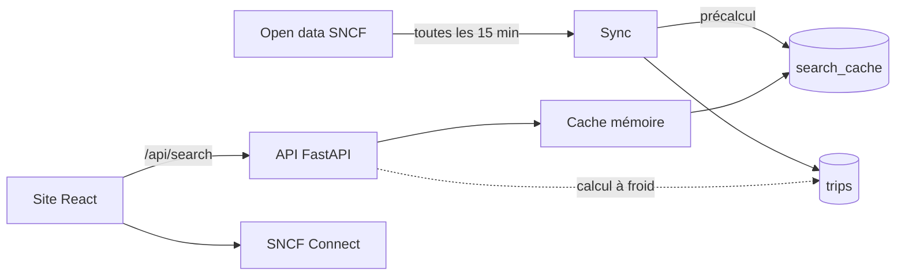

# MaxTracker

Trouvez en un coup d'œil tous les trains **TGV Max à 0 €** au départ de votre gare, directs ou avec une correspondance, puis réservez sur SNCF Connect.

- **Pour qui :** titulaires d'un abonnement **MAX Jeune** ou **MAX Senior**.
- **Ce que c'est :** un outil de repérage **gratuit, indépendant et non officiel**, construit sur les [données ouvertes SNCF](https://data.sncf.com/explore/dataset/tgvmax/).
- **Ce que ce n'est pas :** un site de vente. MaxTracker ne réserve rien, ne demande aucun identifiant SNCF Connect et n'encaisse rien.

---

## Comment ça marche

1. Tapez votre **gare / ville de départ**, au moins 3 lettres. Les noms courants marchent : « Montparnasse », « Part-Dieu », « Saint-Pierre-des-Corps », « Lyon », « Marseille », etc.
2. MaxTracker liste **toutes les destinations** atteignables à 0 € dans les 30 prochains jours, regroupées par ville.
3. Affinez avec les filtres, puis ouvrez **SNCF Connect** depuis le train choisi. Une correspondance donne un lien par train.

Les données viennent du jeu SNCF [« Disponibilités TGV Max »](https://data.sncf.com/explore/dataset/tgvmax/). La SNCF le publie au moins une fois par jour, vers 6 h 30. MaxTracker vérifie toutes les 15 minutes s'il a changé. **Ce n'est pas du temps réel :** vérifiez toujours sur SNCF Connect avant de partir.

## Fonctionnalités

| Besoin | Dans l'application |
|--------|--------------------|
| Voir tous les départs à 0 € | Recherche par gare ou par ville (« Paris (toutes gares) ») |
| Trouver une destination précise | Champ **« Où voulez-vous aller ? »** |
| Changer de train en route | Filtre **1 correspondance** (Direct par défaut) |
| Voir les places qui viennent d'apparaître | Badge **« Nouveau »** et filtre **Nouveautés uniquement** (dernières 24 h de publications SNCF) |
| Partir aujourd'hui, le week-end, le matin… | Filtres *Départ aujourd'hui*, *Week-end*, *Créneaux horaires* |
| Limiter la durée ou la période | Filtres *Durée totale max* (3 / 5 / 8 h) et *Horizon* (7 / 14 / 30 j) |
| Ne garder qu'un type de train | TGV INOUI / OUIGO, Intercités, Intercités de nuit |
| Planifier sur le mois | Vue **Calendrier** : un clic sur un jour affiche ses trajets |
| Repérer les meilleures heures | Vue **Pics horaires** |
| Partager ou retrouver une recherche | L'adresse de la page contient la gare, les filtres et la vue |

Aussi :
- badges **« Départ possible aujourd'hui »** et **« Imminent »** (moins de 4 h) ;
- mention **« +1 j »** quand l'arrivée a lieu le lendemain ;
- **gares favorites** et **destinations masquées**, enregistrées dans votre navigateur ;
- **mode sombre** ;
- **navigation au clavier**.

## Bon à savoir

- **Les correspondances sont calculées, pas garanties par la SNCF.** Chaque train doit être à 0 €, avec un temps de changement minimum :
  - 25 min dans une même gare ;
  - 60 min entre deux gares parisiennes : 30 min pour Nord ↔ Est et Gare de Lyon ↔ Bercy, 40 min pour Gare de Lyon ↔ Austerlitz ;
  - 50 min ailleurs, et 75 min avec Lyon Saint-Exupéry.
- **Des écarts avec SNCF Connect sont normaux.** SNCF Connect voit les places en temps réel, alors que MaxTracker ne voit que la dernière publication open data.
- **Des TGV couplés** (deux numéros, mêmes horaires) n'apparaissent qu'une fois.
- **Service non affilié à la SNCF.** « SNCF », « TGV », « TGV Max », « MAX JEUNE », « MAX ACTIF » et « SNCF Connect » sont des marques de leurs propriétaires. Les données sont utilisées sous la licence du portail [data.sncf.com](https://data.sncf.com/).

Des questions ou un bug ? Ouvrez une [issue GitHub](../../issues). Il n'y a pas de support commercial.

---

<details>
<summary><h2>Pour les développeurs</h2></summary>

API **FastAPI** + **MongoDB** (backend) et **React / Vite** (frontend).

### Démarrage local

**Prérequis :** Python 3.11+, Node.js 20.19+, MongoDB local. Une base distante rend chaque recherche nettement plus lente.

```bash
# MongoDB (macOS)
brew tap mongodb/brew && brew install mongodb-community@8.0
brew services start mongodb/brew/mongodb-community@8.0

# Backend
cd back
cp .env.example .env
python3 -m venv .venv && source .venv/bin/activate
pip install -r requirements-dev.txt
uvicorn server:app --reload --port 8000

# Frontend (autre terminal)
cd front
npm ci
npm start
```

- App : <http://localhost:3000>
- API : <http://localhost:8000/api/>
- Documentation OpenAPI : <http://localhost:8000/docs>

Avec une base vide, une synchronisation se lance au démarrage. Elle importe les trajets en ~5 s, puis précalcule les recherches de toutes les gares (~100 s, en arrière-plan).

**Tests :**
- backend : `cd back && pytest` ;
- frontend : `cd front && npm test && npm run lint`.

La CI GitHub Actions (`.github/workflows/ci.yml`) lance les deux à chaque push et à chaque pull request.

### Fonctionnement



- **Sync** (`services/sync.py`) :
  - garde les trajets marqués éligibles par la SNCF, sur 30 jours, sans les trajets intra-ville ;
  - date l'apparition de chaque trajet pour le badge « Nouveau » ;
  - remplace la collection `trips` d'un coup (`trips_staging` puis `renameCollection`).

  Une seule sync tourne à la fois. Elle est sautée si la SNCF n'a rien publié et que `PIPELINE_VERSION` n'a pas changé.
- **Recherche** (`services/search.py`) :
  - trajets directs, puis correspondances via les métropoles (`domain/connections.py`) ;
  - résultats mis en cache dans Mongo (`search_cache`) et en mémoire, recalculés après chaque sync ;
  - un calcul à froid prend 1 à 2 s et est limité à 10 par minute et par IP.
- **Réponses** : gzip. `connections=0` et `compact=1` allègent la réponse : Paris passe de 640 Ko à 43 Ko. Le front ne charge les correspondances que si le filtre les demande.

### API

Préfixe `/api`.

| Méthode | Route | Rôle |
|---------|-------|------|
| `GET` | `/health` | Supervision : MongoDB et fraîcheur des syncs (`ok` / `degraded` → 200, `down` → 503) |
| `GET` | `/search?origin=…&connections=0\|1&compact=0\|1` | Trajets par destination. Par défaut : réponse complète |
| `GET` | `/stations/search?q=…` | Autocomplétion des gares (accents, tirets, « Saint »/« St », noms usuels) |
| `GET` | `/sync/info` | État de la dernière synchronisation |
| `POST` | `/sync/trigger` | Synchronisation manuelle : 1 toutes les 3 min, sinon 429 + `Retry-After` |

### Configuration

`back/.env` :

| Variable | Défaut | Rôle |
|----------|--------|------|
| `MONGO_URL` | — (obligatoire) | URI MongoDB |
| `DB_NAME` | — (obligatoire) | Nom de la base |
| `CORS_ORIGINS` | `*` | Origines autorisées, séparées par des virgules |
| `SYNC_INTERVAL_MIN` | `15` | Intervalle de vérification des données SNCF |
| `CACHE_WARM_CONCURRENCY` | `8` | Gares précalculées en parallèle après une sync |
| `SEARCH_RESULT_LIMIT` | `20000` | Garde-fou : trajets max. au départ d'une gare (alerte dans les logs) |
| `TRUSTED_PROXY_HOPS` | `0` | Proxys devant l'API, pour la limite par IP (voir [deploiement.md](doc/deploiement.md)) |

Frontend : `REACT_APP_BACKEND_URL`, l'URL du backend sans `/api`.

### Organisation

```
back/
  app/
    api/routes/      health, search, stations, sync
    core/            caches mémoire, limite par IP, IP derrière proxy
    db/              connexion MongoDB et dépôts (trips, sync_state, search_cache)
    domain/          règles métier : correspondances, gares, recherche de gares,
                     trajets nouveaux, type de train, heure de Paris
    services/        sync SNCF, recherche, mise en forme des réponses, client SNCF
  tests/             pytest (les tests MongoDB tournent sur une base jetable)
front/
  src/
    components/      cartes de trajet, filtres, calendrier, barre de recherche…
    hooks/           React Query, focus des fenêtres, thème
    lib/             API, URL partageable, filtres et horaires, liens SNCF Connect
    pages/           Home, About
doc/                 règles de gestion, contraintes, déploiement, diagrammes
```

### Documentation

| Document | Contenu |
|----------|---------|
| [doc/deploiement.md](doc/deploiement.md) | Mise en production sur le VPS, variables, proxys, HTTPS, supervision |
| [doc/regles-de-gestion.md](doc/regles-de-gestion.md) | Règles de gestion |
| [doc/contraintes.md](doc/contraintes.md) | Contraintes données, métier, légales |
| [doc/rapport-limite-correspondances.md](doc/rapport-limite-correspondances.md) | Pourquoi 1 correspondance au maximum |
| [doc/diagrams/](doc/diagrams/) | Sync et recherche pendant une sync |

**Déploiement :** backend et MongoDB sur un VPS, frontend sur Vercel. Voir [doc/deploiement.md](doc/deploiement.md).

**Licence :** à définir. L'usage des données SNCF est soumis aux [conditions du portail open data](https://data.sncf.com/).

</details>
