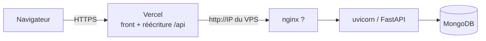

# Déploiement et exploitation

Backend (FastAPI) et MongoDB sur un VPS ; frontend (Vite) sur Vercel, qui relaie `/api/*` vers le VPS (`front/vercel.json`).



## Mettre à jour le backend

```bash
cd back
git pull
pip install -r requirements.txt   # production : sans les outils de test
# redémarrer le service uvicorn
```

- **Python 3.11 minimum** (Starlette 1.x). Motor n'est plus utilisé : PyMongo fournit le client asynchrone.
- Après le redémarrage : `curl -fsS https://<domaine>/api/health` doit répondre `"status": "ok"`.

## Variables d'environnement (`back/.env`)

| Variable | Défaut | Rôle |
|----------|--------|------|
| `MONGO_URL` | — (obligatoire) | URI MongoDB |
| `DB_NAME` | — (obligatoire) | Nom de la base |
| `CORS_ORIGINS` | `*` | Origines autorisées, séparées par des virgules |
| `SYNC_INTERVAL_MIN` | `15` | Intervalle de vérification des données SNCF |
| `CACHE_WARM_CONCURRENCY` | `8` | Origines recalculées en parallèle après une sync |
| `SEARCH_RESULT_LIMIT` | `20000` | Garde-fou : trajets max. au départ d'une gare (alerte dans les logs s'il est atteint) |
| `TRUSTED_PROXY_HOPS` | `0` | Proxys de confiance devant l'API (voir ci-dessous) |

## Régler `TRUSTED_PROXY_HOPS` (limite de requêtes par IP)

Les recherches non mises en cache sont limitées à 10 par minute et par IP. Derrière Vercel, l'IP vue par l'API est celle de Vercel : sans réglage, des utilisateurs différents partagent le même quota.

1. Démarrer l'API, faire une recherche depuis le site public.
2. Lire la ligne écrite une fois au démarrage dans les logs (aucune IP n'y figure) :

   ```
   client IP: TRUSTED_PROXY_HOPS=0, connexion …, X-Forwarded-For à N entrée(s)
   ```

3. Choisir la valeur :

   | Ligne de log | Chaîne | Valeur |
   |--------------|--------|--------|
   | connexion **publique**, 1 entrée | Vercel → uvicorn | `1` |
   | connexion **locale**, 2 entrées | Vercel → nginx → uvicorn | `2` |
   | connexion **locale**, 1 entrée | nginx écrase l'en-tête | corriger nginx (ci-dessous), puis `2` |

   Avec nginx, l'en-tête doit être **complété**, pas remplacé :

   ```nginx
   proxy_set_header X-Forwarded-For $proxy_add_x_forwarded_for;
   ```

4. Mettre la valeur dans `back/.env`, redémarrer.

Limite connue : tant que le VPS accepte des requêtes directes (hors Vercel), un client peut forger `X-Forwarded-For` et contourner le quota. C'est une protection de confort contre les rafales de calculs, pas un contrôle d'accès.

## Chiffrer le trafic Vercel → VPS (à faire)

`front/vercel.json` relaie aujourd'hui vers `http://51.210.245.184` : entre Vercel et le VPS, les requêtes circulent **en clair**, vers une IP écrite en dur. Pour passer en HTTPS :

1. Créer un sous-domaine (ex. `api.mondomaine.fr`) pointant vers l'IP du VPS (enregistrement DNS `A`).
2. Sur le VPS, obtenir un certificat Let's Encrypt pour ce nom (par exemple `certbot --nginx -d api.mondomaine.fr`) et servir l'API en HTTPS via nginx.
3. Dans `front/vercel.json`, remplacer la destination par `https://api.mondomaine.fr/api/:path*`, puis redéployer le front.
4. Optionnel : fermer le port 80 de l'API au public une fois la bascule faite.

## Supervision

`GET /api/health` ne contacte jamais l'API SNCF :

| Statut | HTTP | Signification |
|--------|------|---------------|
| `ok` | 200 | MongoDB répond, synchronisations à jour |
| `degraded` | 200 | Dernière sync en erreur, ou données SNCF de plus de 36 h (`problems` détaille) |
| `down` | 503 | MongoDB injoignable, ou aucune tentative de sync depuis 3 intervalles (planificateur bloqué) |

Un simple `curl -fsS …/api/health` en tâche planifiée suffit à détecter un `down` (code de sortie non nul).

## Intégration continue

`.github/workflows/ci.yml`, à chaque push sur `main`/`develop` et sur chaque pull request :

- **backend** : Python 3.11 + MongoDB 7, `pytest` (les tests MongoDB échouent si la base manque, grâce à `REQUIRE_MONGO=1`) ;
- **frontend** : Node 22, `npm ci`, lint, Vitest, build Vite.
