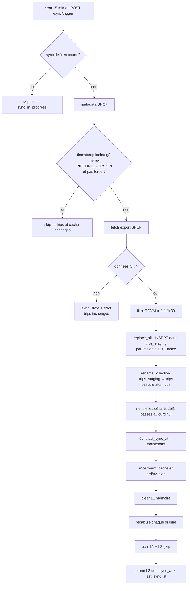

# Sync SNCF → Mongo → warm cache

Toutes les 15 min, on lit d’abord `sncf_data_updated_at`. Si inchangé **et** si les données ont été traitées par la version actuelle du code (`PIPELINE_VERSION`) : **rien** (pas d’export, pas de warm). `POST /api/sync/trigger` force toujours un rebuild.

Une seule sync tourne à la fois : une sync demandée pendant qu’une autre tourne renvoie `{"status": "skipped", "reason": "sync_in_progress"}`. La sync manuelle est limitée à **1 toutes les 3 min pour tout le monde** (au-delà : HTTP 429 + `Retry-After`).

Rebuild : export SNCF → filtre J à J+30 → `replace_all` (staging puis bascule atomique) → `last_sync_at` → warm en fond (L1 vidé, L2 gzip).

Les départs déjà passés sont retirés **à la lecture** du cache, même sans warm.

Si l’API SNCF est down : erreur enregistrée, trips inchangés. Si le metadata est illisible : on fait l’export (pas de skip à l’aveugle).

