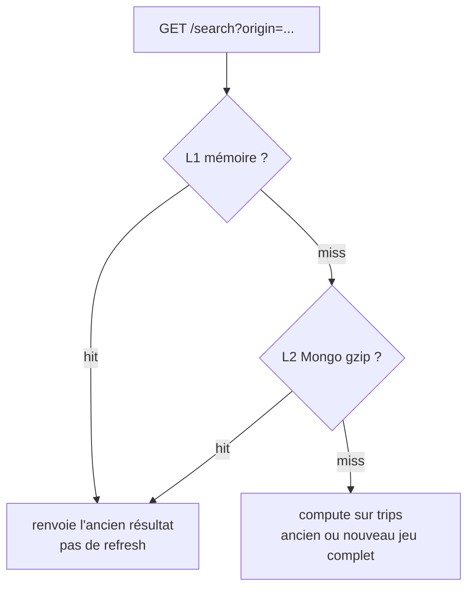

# Recherche pendant le fetch / `replace_all`

`last_sync_at` n’a pas encore changé. Le cache est donc encore considéré à jour : on sert l’**ancienne** réponse, sans refresh.

Une origine **sans cache** est calculée sur `trips`. Le nouveau jeu est écrit dans `trips_staging`, puis basculé d’un seul coup (`renameCollection`) : le calcul voit soit l’ancien jeu complet, soit le nouveau, **jamais** une collection vide ou à moitié remplie.

